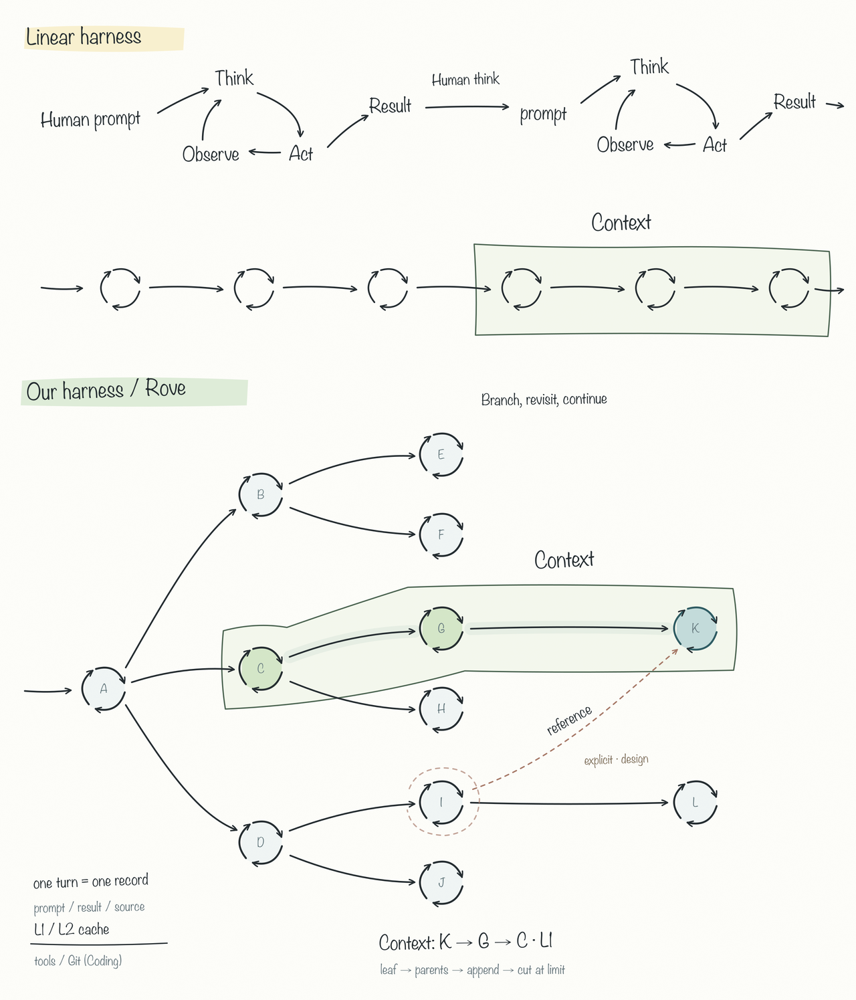

# Rove

Rove explores a graph-based way to work with AI. Start from a question, follow an idea, return to an earlier node, and open another branch. Each path stays available to revisit and continue.

Rove brings learning and coding into one macOS application. Learning mode helps you study PDFs, textbooks, and problem sets. Coding mode connects branching conversations to a local Git project and DeepSeek Harness (dsh). A map holds your questions and their relationships, while a side reader displays source material, answers, code, and changes.

## Branching exploration

A linear harness carries one conversation forward. Rove lets you branch from any turn, revisit earlier nodes, and continue along a different path.



The highlighted path illustrates ancestor-based context selection. Dashed links represent planned explicit references across branches. This diagram describes the context design; see [Project direction](#project-direction) for implementation status.

[View the SVG diagram](docs/images/rove-architecture.svg)

## App preview


Rove is an early prototype. The current interface and default tutoring prompts are in Chinese.

## Exploring with Rove

1. Import a PDF and read it in the side reader.
2. Ask AI to organize the document into knowledge points.
3. Open a knowledge point and ask about a passage, formula, or step you want to understand.
4. Continue from any answer to create a follow-up branch.
5. Return to an earlier node and explore another direction. Your existing branches stay on the map.

You can select text or formulas from an answer, save excerpts, and use them in follow-up questions. Answers support Markdown and LaTeX rendering. You can also edit an answer and switch between the original AI response and your latest revision.

The map supports zoom, fit-to-view, and keyboard navigation. Both the library sidebar and the reading sidebar have draggable dividers, remember their widths, and return to their default widths on double-click.

## Learning context

Each learning turn has its own metadata file, with the question, answer version, selected passage, document and page references, and the exact context sent for that request. Source revisions use content hashes. Each revision has three summary caches: **L0** is an automatic, single-line title (up to 32 UTF-16 units), **L1** is a short summary (up to 240 units), and **L2** retains more detail (up to 1,200 units). All three are generated in one model request and reused; editing an answer creates a new source revision while earlier versions remain available. L0 titles label map nodes and the side reader, with the original question preserved. Opening an older turn automatically fills in its missing title; failed generation can be retried in the metadata panel.

Before a follow-up, choose how many levels to inherit (0–100) and whether to use L0, L1, or L2. The direct parent is level 1. Rove appends selected summaries from the nearest node toward the root, then appends the current learning material. It directly truncates the resulting context at 24,000 UTF-16 units, preserving nearer nodes first. The current question is sent separately. The metadata panel shows the selected nodes and revisions, actual transmitted text, and where content was truncated.

New answers generate all three caches in the background. Older nodes generate missing caches when opened, selected for inheritance, or through the metadata panel. Summary errors are visible and retryable. Cache generation uses the learning model configured in `.env`; changing an answer invalidates the previous source revision's cache for that edited content.

## Coding mode

Switch to **Coding** and open a project folder. Rove automatically initializes Git for a folder without a repository. Select a file to read or edit, ask DSH to explain the code, or ask it to implement a change directly in the selected workspace. The full workspace path is visible in the sidebar, and new files appear while a task runs. Tasks show their elapsed time and processing steps.

Every conversation turn is bound to a unique Git commit, including read-only answers and stopped or failed model runs. The commit records that turn's code, question, answer, and supplied conversation context. A child turn points to its selected parent turn's commit. Reopening an earlier node lets you inspect its code and conversation. Running a new task uses the currently selected workspace's files; viewing history does not change files. To explore an earlier code version in another directory, explicitly choose **Branch in another directory** and select an empty folder.

New Coding runs stream their public DSH events into an append-only JSONL journal with sequence numbers and receipt timestamps. The **Run records** tab shows tool calls, arguments, paired results, public model events, diagnostics, and final status while the task runs. Upstream truncation flags and incomplete-recording warnings stay visible. Credentials are redacted before these events are saved.

At the end of a run, Rove archives the journal as a Git blob pinned under `refs/rove/traces/`, and stores its blob ID, SHA-256, byte count, and event count in that turn's commit metadata. Historical records are paginated from this immutable copy; ancestor tool records can be inspected through their Git metadata. Earlier nodes created before event recording was added have no Rove event journal.

The side reader includes conversation, code, diff, and run-record tabs. File saves check for external changes. You can inspect a turn's before-and-after versions and explicitly commit working-tree changes. Turn records are retained under local `refs/rove/turns/` references in the selected repository.

Coding mode bundles **DeepSeek Harness (dsh)**. Configure `DEEPSEEK_API_KEY` in the project `.env`, then refresh the engine in Coding mode. The default `DEEPSEEK_BASE_URL` is `https://api.deepseek.com/anthropic`, a Messages-compatible endpoint. Set `DEEPSEEK_MODEL` to choose a model, or leave it empty to use the bundled harness default. Your existing Git author and committer configuration is used for snapshots and conversation commits.

## Project direction

Rove investigates a graph-based AI harness in which users can branch, revisit, and switch between exploration paths, with AI tutoring as the first use case.

The proposed context mechanism starts at the active node and follows its ancestors, selecting summaries or original material according to the current question and available context budget. Traceable sources and versioned context would let users inspect the information behind each answer.

The prototype stores questions through parent–child links. Learning mode uses user-selected ancestor depth and L0/L1/L2 summaries, with request snapshots and versioned caches. Coding mode supplies the selected ancestor conversation path and code context, with each turn's input, result, and public tool events recorded in Git. The two modes currently use separate context builders; a reusable harness API remains an area for development.

## Tech stack

| Component | Technology | Role |
| --- | --- | --- |
| Desktop runtime | Electron 45.3.1 | macOS application window, native PDF picker, file access, and model requests |
| Interface | Vue 3 | Reactive conversation map, recursive question cards, and side readers |
| Language | TypeScript | Renderer, preload bridge, and main-process application code |
| Build tooling | electron-vite and Vite | Development server and builds for the Electron main, preload, and renderer processes |
| PDF reader | PDF.js (`pdfjs-dist`) | Page rendering, text selection, and text extraction |
| Math rendering | KaTeX | LaTeX formulas in explanations, questions, and excerpts |
| Markdown | Marked with a custom Vue renderer | Markdown parsing and rendered content |
| Local persistence | Chromium localStorage, local metadata/cache files, PDF files, and IndexedDB for older imports | Saved questions, revisions, excerpts, source documents, and request context snapshots |
| AI integration | OpenAI-compatible Chat Completions API | Configurable model provider through `.env` |
| Coding engine | DeepSeek Harness (`@deepseek-ai/dsh`) | Code questions and implementations in the selected workspace; optional branches in a user-selected directory |
| Coding runtime | Node.js 24.22.1 and npm 11.6.2 | Bundled standalone runtime for DSH and JavaScript project commands |
| Code versioning | Git | Per-turn commits, immutable code snapshots, branch worktrees, and diffs |

The canvas uses Vue components and SVG connection paths. Electron's preload bridge exposes PDF and AI operations to the renderer. Model configuration is read in the main process.

## Run locally

Use macOS and Node.js **24.9 or newer**. From a fresh checkout, run these commands in the project root.

```sh
npm ci
cp .env.example .env
npm run dev
```

`npm run dev` installs the Electron runtime if needed and starts the desktop application. You can import and read PDFs before configuring a model.

## Configure a model

Edit `.env` in the project root with your provider's base URL, model ID, and API key.

```dotenv
OPENAI_BASE_URL=https://api.openai.com/v1
OPENAI_MODEL=your-model-id
OPENAI_API_KEY=your-api-key
```

| Variable | Purpose |
| --- | --- |
| `OPENAI_BASE_URL` | API base URL. Rove appends `/chat/completions` when making a request. |
| `OPENAI_MODEL` | Model ID accepted by the configured provider. |
| `OPENAI_API_KEY` | Authentication key required by the provider. A local service may allow an empty value. |

Use HTTPS for remote providers. HTTP is supported for `localhost`, `127.0.0.1`, and `[::1]`.

The **AI settings** button can reveal `.env` in Finder. Save your changes and return to Rove to refresh the displayed configuration. Each model request reads the configuration again.

For a packaged build, place `.env` beside `Rove.app`.

## Build the macOS app

To package directly from a fresh checkout, install dependencies and the Electron runtime before building.

```sh
npm ci
npm exec -- install-electron
npm run package:mac
```

The output is `Rove.app` in the project root. The packaging script uses Electron 45.3.1 and bundles DSH with a separate Node.js 24.22.1 runtime and npm 11.6.2. The packaged app does not require a global DSH or Node installation.

To build the application code on its own, run `npm run build`. Build output is written to `out/`.

## Data and model requests

Imported PDFs and study records are stored on your Mac. Learning turn metadata, source revisions, summary caches, and context snapshots are stored under `study-context/` in the application data directory. The current data directory is `~/Library/Application Support/知序`, retained from earlier builds. Reimporting a PDF with identical contents opens its existing study record.

When you organize a document or ask a question, Rove sends the relevant document text and question context to the model provider configured in `.env`. API keys are read by the Electron main process. `.env`, build output, installed dependencies, and `Rove.app` are excluded by `.gitignore`.

Coding actions send the task, conversation path, and selected code to the DeepSeek provider configured for dsh. Project registrations and workspace paths are kept in the application data directory; project source files stay in the workspace you select. Separate branch worktrees are created only in a directory you explicitly choose. Per-turn commits and their conversation records are stored locally in the selected Git repository.

## Current limits

- Automatic knowledge-point generation uses extractable PDF text. Scanned PDFs can be viewed. OCR is a future extension.
- Learning-mode inheritance uses the selected L0/L1/L2 caches. L0 carries only the turn title; use L1 or L2 when the follow-up needs conclusions or reasoning details. Fetching historical PDF page text automatically is a further improvement; page text is currently included when available in the reader.
- Learning-mode context is capped at 24,000 UTF-16 units with visible truncation. Questions over 4,000 units are rejected before sending. Summary generation separately marks truncated inputs or outputs while keeping the original source metadata.
- Answer editing keeps the original response and the latest revision. Coding-mode Git records retain the original completed turn, with revisions included in later turns when selected as context.
- Source-page links help readers check the original document. Answer verification is a further research goal.
