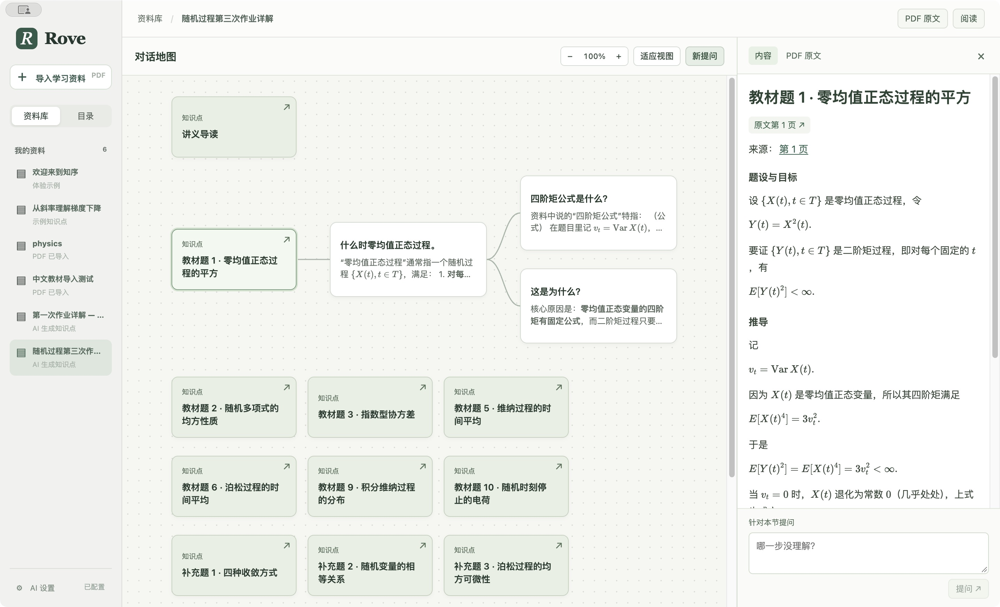

# Rove

Rove explores a graph-based way to work with AI. Start from a question, follow an idea, return to an earlier node, and open another branch. Each path stays available to revisit and continue.

The first application is a macOS AI tutor for studying PDFs, textbooks, and problem sets. A conversation map holds your questions and their relationships, while a side reader displays source material and answers.



Rove is an early prototype. The current interface and default tutoring prompts are in Chinese.

## Exploring with Rove

1. Import a PDF and read it in the side reader.
2. Ask AI to organize the document into knowledge points.
3. Open a knowledge point and ask about a passage, formula, or step you want to understand.
4. Continue from any answer to create a follow-up branch.
5. Return to an earlier node and explore another direction. Your existing branches stay on the map.

You can select text or formulas from an answer, save excerpts, and use them in follow-up questions. Answers support Markdown and LaTeX rendering. You can also edit an answer and switch between the original AI response and your latest revision.

The map supports zoom, fit-to-view, and keyboard navigation. Both the library sidebar and the reading sidebar have draggable dividers, remember their widths, and return to their default widths on double-click.

## Project direction

Rove investigates a graph-based AI harness in which users can branch, revisit, and switch between exploration paths, with AI tutoring as the first use case.

The proposed context mechanism starts at the active node and follows its ancestors, selecting summaries or original material according to the current question and available context budget. Traceable sources and versioned context would let users inspect the information behind each answer.

The current prototype stores questions through parent–child links and builds each request from the active knowledge point, selected passage, and direct parent question and answer. Ancestor summary retrieval, complete context snapshots, and a reusable harness API are areas for further development.

## Tech stack

| Component | Technology | Role |
| --- | --- | --- |
| Desktop runtime | Electron 45.3.1 | macOS application window, native PDF picker, file access, and model requests |
| Interface | Vue 3 | Reactive conversation map, recursive question cards, and side readers |
| Language | TypeScript | Renderer, preload bridge, and main-process application code |
| Build tooling | electron-vite and Vite | Development server and builds for the Electron main, preload, and renderer processes |
| PDF reader | PDF.js (`pdfjs-dist`) | Page rendering, text selection, and text extraction |
| Math rendering | KaTeX | LaTeX formulas in explanations, questions, and excerpts |
| Markdown | Marked with a custom Vue renderer | Markdown parsing and rendered content |
| Local persistence | Chromium localStorage, local PDF files, and IndexedDB for older imports | Saved questions, revisions, excerpts, and source documents |
| AI integration | OpenAI-compatible Chat Completions API | Configurable model provider through `.env` |

The canvas uses Vue components and SVG connection paths. Electron's preload bridge exposes PDF and AI operations to the renderer. Model configuration is read in the main process.

## Run locally

Use macOS and Node.js **22.12 or newer**. From a fresh checkout, run these commands in the project root.

```sh
npm ci
cp .env.example .env
npm run dev
```

`npm run dev` installs the Electron runtime if needed and starts the desktop application. You can import and read PDFs before configuring a model.

## Configure a model

Edit `.env` in the project root with your provider's base URL, model ID, and API key.

```dotenv
OPENAI_BASE_URL=https://api.openai.com/v1
OPENAI_MODEL=your-model-id
OPENAI_API_KEY=your-api-key
```

| Variable | Purpose |
| --- | --- |
| `OPENAI_BASE_URL` | API base URL. Rove appends `/chat/completions` when making a request. |
| `OPENAI_MODEL` | Model ID accepted by the configured provider. |
| `OPENAI_API_KEY` | Authentication key required by the provider. A local service may allow an empty value. |

Use HTTPS for remote providers. HTTP is supported for `localhost`, `127.0.0.1`, and `[::1]`.

The **AI settings** button can reveal `.env` in Finder. Save your changes and return to Rove to refresh the displayed configuration. Each model request reads the configuration again.

For a packaged build, place `.env` beside `Rove.app`.

## Build the macOS app

To package directly from a fresh checkout, install dependencies and the Electron runtime before building.

```sh
npm ci
npm exec -- install-electron
npm run package:mac
```

The output is `Rove.app` in the project root. The packaging script uses the installed Electron 45.3.1 runtime.

To build the application code on its own, run `npm run build`. Build output is written to `out/`.

## Data and model requests

Imported PDFs and study records are stored on your Mac. The current data directory is `~/Library/Application Support/知序`, retained from earlier builds. Reimporting a PDF with identical contents opens its existing study record.

When you organize a document or ask a question, Rove sends the relevant document text and question context to the model provider configured in `.env`. API keys are read by the Electron main process. `.env`, build output, installed dependencies, and `Rove.app` are excluded by `.gitignore`.

## Current limits

- Automatic knowledge-point generation uses extractable PDF text. Scanned PDFs can be viewed. OCR is a future extension.
- Follow-ups currently include the direct parent question and answer. Full ancestor traversal and automatic ancestor summaries are part of the proposed context mechanism.
- Request context is capped at 24,000 UTF-16 code units, with a separate 4,000-unit cap for the question. Longer input is truncated.
- Answer editing keeps the original response and the latest revision. Versioned history and saved snapshots of the exact context used for each request are future work.
- Source-page links help readers check the original document. Answer verification is a further research goal.
